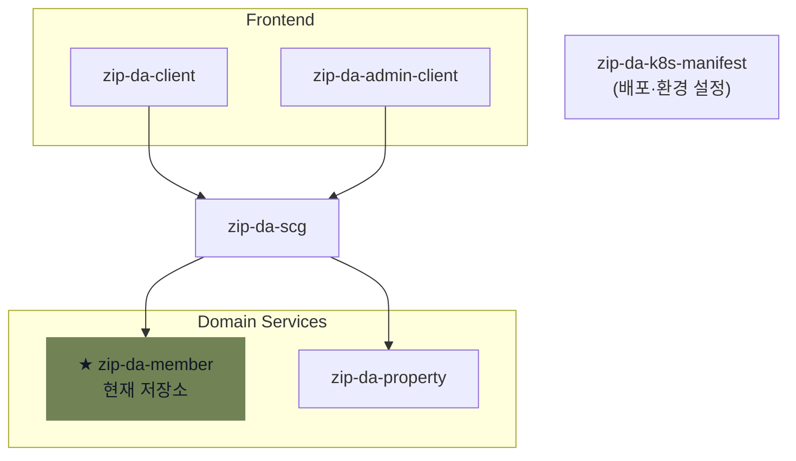

# ZIPDA Member 서비스

> **ZIPDA**는 사용자와 중개사를 연결하고 회원 관리, 중개사 인증, 매물 탐색·관리 기능을 제공하는 **MSA(Microservices Architecture)** 기반 부동산 서비스이다.

`zip-da-member`는 ZIPDA MSA에서 회원·인증·인가·중개사 전환·관리자 계정을 담당하는 Spring Boot 서비스이다. 외부 요청은 원칙적으로 API Gateway(`zip-da-scg`)를 거치며, Member는 회원 상태와 권한의 기준 데이터를 관리한다. Property 서비스는 매물 데이터를 소유하고, 매물 등록·수정 전 Member의 내부 권한 API를 호출한다.

## ZIPDA MSA 구성



## 주요 기능

- 일반 회원 가입, 이메일 로그인, 로그아웃, 비밀번호 재설정
- 회원가입·비밀번호 변경을 위한 이메일 인증과 만료·재시도 관리
- Access/Refresh JWT 발급, Refresh Token 세션 회전·폐기
- 내 프로필과 프로필 이미지 관리
- 중개사 전환 신청, OCR 기반 증빙 서류 자동 입력, 관리자 심사
- 국세청·국토교통부 공공데이터 스케줄링 검증
- 비공개 증빙 문서 저장, 5분 만료 Presigned URL, 관리자 열람 감사 이력
- 중개사 공개 프로필과 전문 지역·영업시간 관리
- 회원 제재, 중개소 운영 상태, 관리자 계정·역할과 감사 이력 관리
- Property 서비스의 매물 등록·수정 전 회원 권한 조회

## 공통 운영 기능

- Hibernate Filter와 AOP를 이용한 논리 삭제 기본 조회 및 관리자 예외 조회
- 매일 실행되는 이메일 인증 데이터 정리와 중개사 신청 외부 검증
- 전역 예외 처리와 `code`, `message`, `data`, `traceId` 공통 응답
- `X-Trace-Id`를 이용한 요청·응답·로그 상관관계 추적

## 기술 스택

| 영역 | 기술 |
| --- | --- |
| 실행 환경 | Java 21 |
| 프레임워크 | Spring Boot 4.1.1, Spring MVC, Spring Security |
| 데이터 접근·저장 | Spring Data JPA, QueryDSL 5.1, MySQL |
| 인증·인가 | Spring Security, JJWT 0.12.6 |
| 파일 저장·OCR | MinIO, Google Cloud Vision/Storage |
| 외부 연동 | Gmail SMTP, NTS, MOLIT |
| API 문서 | springdoc-openapi 3.0.3 |
| 빌드·CI | Gradle Wrapper, GitHub Actions (`bootJar`) |

## 아키텍처 요약

```text
┌──────────────────────────────────────────────┐
│ Client / Admin Client (Vue 3, Postman)       │
└──────────────────────┬───────────────────────┘
                       │ HTTPS
┌──────────────────────▼───────────────────────┐
│ API Gateway (zip-da-scg)                     │
│ JWT 검증, 경로 라우팅, X-User-* 헤더 생성    │
└──────────────────────┬───────────────────────┘
                       │ /api/member/**
┌──────────────────────▼───────────────────────┐
│ Member Service (zip-da-member)               │
│ Filter → Controller → Service → Repository   │
└──────────────┬───────────────┬───────────────┘
               │               │
┌──────────────▼───────────┐   ┌▼───────────────────────────┐
│ Member MySQL             │   │ MinIO / 외부 연동          │
│ JPA · QueryDSL           │   │ Mail · NTS · MOLIT         │
└──────────────────────────┘   │ Google Cloud Vision        │
                               └─────────────────────────────┘

Property Service ── GET /internal/members/{id}/permissions
                 ──▶ Member Service
```

보호 API 요청은 Gateway가 Access Token을 검증하는 무상태 흐름으로 처리한다. 다만 Refresh Token은 Member DB의 세션 정보로 저장해 회전·폐기한다.

- Gateway: Access Token 검증과 내부 인증 헤더 생성
- Member: `HeaderAuthenticationFilter`와 `@PreAuthorize`로 인증 정보 적용, Refresh Token 세션 관리
- 서비스 간 연동: Member는 권한 판단의 기준 서비스이고, Property는 매물 등록·수정 전에 Member 내부 API를 동기 호출
- V3 예정: Kafka는 즉시 권한 판단이 아닌 상태 변경 후속 처리를 위한 부가 연동으로 검토

Member 포트를 외부에 직접 노출하면 안 된다. 클라이언트가 보낸 `X-User-*` 헤더도 그대로 전달하면 안 된다.

## 문서

| 문서 | 내용 |
| --- | --- |
| [Member 서비스 개요](zip-da-member-doc/01-service-overview.md) | 서비스 목적, 대표 기능, 기술 스택과 요청 흐름 |
| [ERD & 데이터베이스](zip-da-member-doc/02-erd-and-database.md) | ERD, 테이블·컬럼 명세와 삭제·참조 정책 |
| [Member 서비스 아키텍처](zip-da-member-doc/03-architecture.md) | 서비스 경계, 계층 구조, Gateway 신뢰 조건과 Member-Property 연동 |
| [API 명세](zip-da-member-doc/04-api-specification.md) | Controller 기준 엔드포인트, 권한과 내부 권한 조회 계약 |
| [JWT 인증 가이드](zip-da-member-doc/05-jwt-authentication.md) | Token Claim, Cookie, 세션 회전과 Gateway 연동 규칙 |
| [주요 기능](zip-da-member-doc/06-key-features.md) | OCR·자동 검증, 파일 보안, 중개사·관리자 업무와 RBAC |
| [개발 환경 세팅](zip-da-member-doc/07-development-setup.md) | 환경 변수, DB 스키마, 실행 검증과 Swagger 설정 |

## 개발 환경

로컬 실행, 환경 변수, DB 스키마 적용과 OpenAPI 확인 방법은 [개발 환경 세팅](zip-da-member-doc/07-development-setup.md)을 참고한다.

## API와 응답

- 외부 API 기본 경로: `/api/member`
- 관리자 API 기본 경로: `/api/member/admin`
- 내부 서비스 API: `/internal/members` (클라이언트 공개 API가 아닌 서비스 간 호출 경로)
- 보호 API: `Authorization: Bearer <access-token>`을 Gateway에 전달
- Refresh Token: 응답 body가 아닌 `HttpOnly` Cookie 사용

공통 응답은 `code`, `message`, `data`, `traceId`를 포함한다. 예시와 DTO별 계약은 [API 명세](zip-da-member-doc/04-api-specification.md)를 참고하고, 실행 중 생성되는 `/api-docs`에서 Member 서비스의 API 계약을 확인한다.

## Swagger/OpenAPI

- 운영 통합 Swagger UI: <https://zipda-be.meerkat.p-e.kr/docs>
- Member 서비스 OpenAPI JSON: `/api-docs`

Member 자체 Swagger UI는 비활성화하며, Gateway에서 통합 UI를 제공한다.

로컬 Swagger UI 활성화 방법은 [개발 환경 세팅의 Swagger/OpenAPI 설정](zip-da-member-doc/07-development-setup.md#4-swaggeropenapi-설정)을 참고한다.
