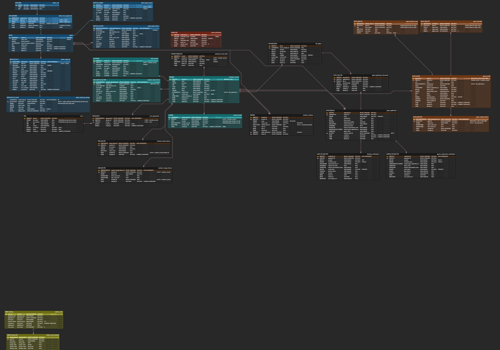

# ERD & 데이터베이스

[README로 돌아가기](../README.md)

이 문서는 `테이블명세서_member.xlsx`의 `Sheet1`에 정의된 29개 테이블과 267개 컬럼을 정리한다. 명세서의 값은 설계 기준이며, 실제 MySQL에 적용된 DDL이나 데이터 존재 여부를 확인한 결과는 아니다.

## 1. ERD 다이어그램

## 2. 테이블 목록

테이블명을 선택하면 3절의 전체 컬럼 명세로 이동한다.

| 영역 | 테이블 | 역할 |
| --- | --- | --- |
| 회원·인증 | [`member_account`](#3-1-member_account) | 회원 계정과 상태 |
| 회원·인증 | [`social_account`](#3-2-social_account) | 소셜 계정 연결 |
| 회원·인증 | [`email_verification`](#3-8-email_verification) | 이메일 인증 코드와 만료 |
| 회원·인증 | [`password_reset_token`](#3-11-password_reset_token) | 비밀번호 재설정 토큰 |
| 회원·인증 | [`login_session`](#3-9-login_session) | 회원 Refresh 세션 |
| 회원·인증 | [`term`](#3-6-term) | 약관 버전 |
| 회원·인증 | [`term_agreement`](#3-7-term_agreement) | 회원별 약관 동의 |
| 관리자 | [`admin`](#3-3-admin) | 관리자 계정 |
| 관리자 | [`admin_role`](#3-5-admin_role) | 관리자 역할 코드 |
| 관리자 | [`admin_role_assignment`](#3-4-admin_role_assignment) | 관리자 역할 할당 |
| 관리자 | [`admin_login_session`](#3-10-admin_login_session) | 관리자 Refresh 세션 |
| 관리자 | [`admin_login_history`](#3-26-admin_login_history) | 관리자 로그인 이력 |
| 관리자 | [`member_login_history`](#3-25-member_login_history) | 회원 로그인 이력 |
| 중개사·파일 | [`agent_application`](#3-13-agent_application) | 중개사 전환 신청 |
| 중개사·파일 | [`agent_application_document`](#3-14-agent_application_document) | 신청 증빙 파일 연결 |
| 중개사·파일 | [`business_verification`](#3-15-business_verification) | 사업자 정보 검증 이력 |
| 중개사·파일 | [`agency_registration_verification`](#3-29-agency_registration_verification) | 중개사무소 등록 검증 이력 |
| 중개사·파일 | [`agent_profile`](#3-12-agent_profile) | 승인된 중개사 프로필 |
| 중개사·파일 | [`agent_specialty`](#3-18-agent_specialty) | 중개사 전문 지역 |
| 중개사·파일 | [`agent_business_hour`](#3-19-agent_business_hour) | 중개사 영업시간 |
| 중개사·파일 | [`file_object`](#3-16-file_object) | 파일 메타데이터 |
| 제재·이력 | [`member_sanction`](#3-17-member_sanction) | 회원 제재 |
| 제재·이력 | [`member_status_history`](#3-20-member_status_history) | 회원 상태 변경 이력 |
| 제재·이력 | [`member_change_history`](#3-21-member_change_history) | 회원 필드 변경 이력 |
| 제재·이력 | [`agent_change_history`](#3-22-agent_change_history) | 중개사 필드 변경 이력 |
| 제재·이력 | [`admin_audit_log`](#3-27-admin_audit_log) | 관리자 행위 감사 |
| 제재·이력 | [`admin_audit_log_change`](#3-28-admin_audit_log_change) | 감사 로그의 필드별 변경 |
| 이벤트 | [`outbox_event`](#3-24-outbox_event) | 발행 대기·재시도 상태 |
| 이벤트 | [`outbox_event_payload`](#3-23-outbox_event_payload) | 이벤트 payload 필드 |

## 3. 모든 테이블 명세서

원본 명세서의 29개 테이블과 267개 컬럼을 옮겼다. 빈 셀은 `—`로 표시하고, 그 밖의 값은 원본 표기를 따른다.

### 3-1. member_account

| 컬럼 한글명 | 컬럼 | 데이터 타입 | NULL 허용 | 기본값 | 제약 | 설명 |
| --- | --- | --- | --- | --- | --- | --- |
| 회원 아이디 | `member_id` | `BIGINT_UNSIGNED` | NOT NULL | — | PK | 서비스 간 공유 식별자. 다른 서비스는 논리 참조만 보유 |
| 이메일 | `email` | `VARCHAR(255)` | NOT NULL | — | UNIQUE | 표시·알림용. 검색용 email_hash 별도 저장 |
| 비밀번호 | `password` | `VARCHAR(255)` | NULL | — | — | 소셜 전용 계정은 NULL 가능. BCrypt/Argon2 정책 |
| 성명 | `name` | `VARCHAR(50)` | NOT NULL | — | — | 민감정보 접근 시 마스킹 |
| 닉네임 | `nickname` | `VARCHAR(50)` | NOT NULL | — | UNIQUE | 검색용 nickname_hash 고려 |
| 연락처 | `phone` | `VARCHAR(20)` | NOT NULL | — | — | — |
| 계정 상태 | `status` | `VARCHAR(20)` | NOT NULL | `ACTIVE` | — | ACTIVE / LOCKED / SUSPENDED / WITHDRAWN |
| 프로필 파일 아이디 | `profile_file_id` | `BIGINT_UNSIGNED` | NULL | — | 논리 FK → file_object | 프로필 이미지 파일 참조 |
| 역할 | `member_role` | `VARCHAR(10)` | NOT NULL | `USER` | — | USER / AGENT / |
| 이메일 인증일 | `email_verification_at` | `DATETIME` | NULL | — | — | 이메일 인증 된 경우 값 일증일자 등록 |
| 탈퇴일 | `withdrawn_at` | `DATETIME` | NULL | — | — | 탈퇴 전환 시각 |
| 작성일 | `created_at` | `DATETIME` | NOT NULL | `CURRENT_TIMESTAMP` | — | 가입일 |
| 수정일 | `updated_at` | `DATETIME` | NOT NULL | `CURRENT_TIMESTAMP` | — | — |

### 3-2. social_account

| 컬럼 한글명 | 컬럼 | 데이터 타입 | NULL 허용 | 기본값 | 제약 | 설명 |
| --- | --- | --- | --- | --- | --- | --- |
| 소셜 계정 아이디 | `social_account_id` | `BIGINT_UNSIGNED` | NOT NULL | — | PK | — |
| 회원 아이디 | `member_id` | `BIGINT_UNSIGNED` | NOT NULL | — | 논리 FK → member_account | — |
| 제공자 | `provider` | `VARCHAR(20)` | NOT NULL | — | UNIQUE(provider, provider_user_id) | KAKAO |
| 제공자 사용자 아이디 | `provider_user_id` | `VARCHAR(100)` | NOT NULL | — | UNIQUE(provider, provider_user_id) | — |
| 제공자 이메일 | `provider_email` | `VARCHAR(255)` | NULL | — | — | — |
| 작성일 | `created_at` | `DATETIME` | NOT NULL | `CURRENT_TIMESTAMP` | — | 연결일 |

### 3-3. admin

| 컬럼 한글명 | 컬럼 | 데이터 타입 | NULL 허용 | 기본값 | 제약 | 설명 |
| --- | --- | --- | --- | --- | --- | --- |
| 관리자 아이디 | `admin_id` | `BIGINT_UNSIGNED` | NOT NULL | — | PK | — |
| 관리자 코드 | `admin_code` | `VARCHAR(20)` | NOT NULL | — | UNIQUE | 관리자 로그인 아이디 |
| 비밀번호 | `admin_password` | `VARCHAR(255)` | NOT NULL | — | — | BCrypt 암호화 |
| 임시비밀번호여부 | `password_change_required` | `BOOLEAN` | NULL | — | — | 최초 임시 비빌번호 변경용 |
| 성명 | `admin_name` | `VARCHAR(50)` | NOT NULL | — | — | — |
| 작성일 | `created_at` | `DATETIME` | NOT NULL | `CURRENT_TIMESTAMP` | — | 가입일 |
| 수정일 | `updated_at` | `DATETIME` | NOT NULL | `CURRENT_TIMESTAMP` | — | — |
| 삭제일 | `deleted_at` | `DATETIME` | NULL | — | — | soft delete |

### 3-4. admin_role_assignment

| 컬럼 한글명 | 컬럼 | 데이터 타입 | NULL 허용 | 기본값 | 제약 | 설명 |
| --- | --- | --- | --- | --- | --- | --- |
| 권한할당아이디 | `assignment_id` | `BIGINT_UNSIGNED` | NOT NULL | — | PK | — |
| 관리자 아이디 | `admin_id` | `BIGINT_UNSIGNED` | NOT NULL | — | 논리FK → admin | — |
| 역할 코드 | `role_code` | `VARCHAR(30)` | NOT NULL | — | 논리FK → admin_role | SUPER_ADMIN / CS_ADMIN / SALES_ADMIN / SYSTEM |
| 부여일 | `assigned_at` | `DATETIME` | NOT NULL | `CURRENT_TIMESTAMP` | — | — |
| 부여자 | `assigned_by` | `BIGINT_UNSIGNED` | NULL | — | 논리 FK → admin | 시스템 부여 시 SYSTEM |
| 삭제일 | `deleted_at` | `DATETIME` | NULL | — | — | 회수일 |

### 3-5. admin_role

| 컬럼 한글명 | 컬럼 | 데이터 타입 | NULL 허용 | 기본값 | 제약 | 설명 |
| --- | --- | --- | --- | --- | --- | --- |
| 역할 코드 | `role_code` | `VARCHAR(30)` | NOT NULL | — | PK | RBAC 역할 코드(SUPER_ADMIN / CS_ADMIN / SALES_ADMIN / SYSTEM) |
| 역할명 | `role_name` | `VARCHAR(50)` | NOT NULL | — | — | 표시용 역할명 |
| 설명 | `description` | `VARCHAR(255)` | NULL | — | — | — |

### 3-6. term

| 컬럼 한글명 | 컬럼 | 데이터 타입 | NULL 허용 | 기본값 | 제약 | 설명 |
| --- | --- | --- | --- | --- | --- | --- |
| 약관아이디 | `term_id` | `BIGINT_UNSIGNED` | NOT NULL | — | PK | — |
| 약관종류 | `term_type` | `VARCHAR(30)` | NULL | — | UNIQUE(term_type, term_version) | SERVICE: 이용약관 / PRIVACY: 개인정보 / MARKETING: 마케팅 |
| 버전 | `term_version` | `VARCHAR(10)` | NULL | — | UNIQUE(term_type, term_version) | v1.0 |
| 제목 | `title` | `VARCHAR(100)` | NULL | — | — | — |
| 내용 | `content` | `VARCHAR(2000)` | NULL | — | — | — |
| 필수여부 | `is_required` | `BOOLEAN` | NOT NULL | `false` | — | 1(TRUE): 필수 동의 / 0(FALSE): 선택 동의 |
| 활성상태 | `status` | `BOOLEAN` | NOT NULL | `true` | — | ACTIVE: 현재 사용중 / INACTIVE: 과거 버전 |
| 등록일시 | `created_at` | `DATETIME` | NOT NULL | `CURRENT_TIMESTAMP` | — | 약관 버전이 개정된 일시 |

### 3-7. term_agreement

| 컬럼 한글명 | 컬럼 | 데이터 타입 | NULL 허용 | 기본값 | 제약 | 설명 |
| --- | --- | --- | --- | --- | --- | --- |
| 약관동의이력 아이디 | `agreement_id` | `BIGINT_UNSIGNED` | NOT NULL | `AUTO_INCREMENT` | PK | — |
| 회원 아이디 | `member_id` | `BIGINT_UNSIGNED` | NOT NULL | — | 논리FK → member_account | — |
| 약관 아이디 | `term_id` | `BIGINT_UNSIGNED` | NOT NULL | — | 논리FK → term | — |
| 동의여부 | `is_agreed` | `BOOLEAN` | NOT NULL | `false` | — | 1(TRUE): 동의함 / 0(FALSE): 철회·미동의 (선택 약관용) |
| 등록일시 | `created_at` | `DATETIME` | NOT NULL | `CURRENT_TIMESTAMP` | — | 동의/철회 일시 |

### 3-8. email_verification

| 컬럼 한글명 | 컬럼 | 데이터 타입 | NULL 허용 | 기본값 | 제약 | 설명 |
| --- | --- | --- | --- | --- | --- | --- |
| 인증 아이디 | `verification_id` | `BIGINT_UNSIGNED` | NOT NULL | — | PK | — |
| 인증 이메일 | `verification_email` | `CHAR(64)` | NOT NULL | — | INDEX | — |
| 인증 목적 | `purpose` | `VARCHAR(30)` | NOT NULL | `SIGNUP` | — | SIGNUP / PASSWORD_RESET |
| 인증 코드 | `verification_code` | `CHAR(64)` | NOT NULL | — | — | 6자리 인증번호 원문 미저장 |
| 만료일 | `expires_at` | `DATETIME` | NOT NULL | — | — | 기본 5분 |
| 시도 횟수 | `attempt_count` | `INT UNSIGNED` | NOT NULL | `0` | — | 실패 횟수 제한 |
| 인증일 | `verified_at` | `DATETIME` | NULL | — | — | — |
| 생성일시 | `created_at` | `DATETIME` | NOT NULL | — | — | — |

### 3-9. login_session

| 컬럼 한글명 | 컬럼 | 데이터 타입 | NULL 허용 | 기본값 | 제약 | 설명 |
| --- | --- | --- | --- | --- | --- | --- |
| 세션 아이디 | `session_id` | `BIGINT_UNSIGNED` | NOT NULL | — | PK | — |
| 회원 아이디 | `member_id` | `BIGINT_UNSIGNED` | NOT NULL | — | 논리FK → member_account | — |
| Refresh Token | `refresh_token` | `VARCHAR(512)` | NOT NULL | — | UNIQUE | 원문 토큰 미저장 |
| 기기 아이디 | `device_id` | `CHAR(26)` | NULL | — | — | — |
| User-Agent | `user_agent` | `VARCHAR(512)` | NULL | — | — | 요청을 보낸 브라우저·앱·운영체제 계열을 나타내는 HTTP User-Agent 헤더를 저장하는 컬럼 Windows / Chrome 등 |
| IP | `ip` | `VARCHAR(20)` | NULL | — | — | — |
| 만료일 | `expires_at` | `DATETIME` | NOT NULL | — | — | — |
| 생성일시 | `created_at` | `DATETIME` | NOT NULL | `CURRENT_TIMESTAMP` | — | — |
| 폐기일시 | `revoked_at` | `DATETIME` | NULL | — | — | 애플리케이션 서버가 DB에 저장해 관리하는 사용자별·기기별 로그인 세션의 유효기간 |

### 3-10. admin_login_session

| 컬럼 한글명 | 컬럼 | 데이터 타입 | NULL 허용 | 기본값 | 제약 | 설명 |
| --- | --- | --- | --- | --- | --- | --- |
| 세션 아이디 | `session_id` | `BIGINT_UNSIGNED` | NOT NULL | — | PK | — |
| 관리자 아이디 | `admin_id` | `BIGINT_UNSIGNED` | NOT NULL | — | 논리FK → admin | — |
| Refresh Token | `refresh_token` | `VARCHAR(512)` | NOT NULL | — | UNIQUE | 원문 토큰 미저장 |
| 기기 아이디 | `device_id` | `CHAR(26)` | NULL | — | — | — |
| User-Agent | `user_agent` | `VARCHAR(512)` | NULL | — | — | — |
| IP | `ip` | `VARCHAR(20)` | NULL | — | — | — |
| 만료일 | `expires_at` | `DATETIME` | NOT NULL | — | — | — |
| 생성일시 | `created_at` | `DATETIME` | NOT NULL | `CURRENT_TIMESTAMP` | — | — |
| 폐기일시 | `revoked_at` | `DATETIME` | NULL | — | — | 애플리케이션 서버가 DB에 저장해 관리하는 사용자별·기기별 로그인 세션의 유효기간 |

### 3-11. password_reset_token

| 컬럼 한글명 | 컬럼 | 데이터 타입 | NULL 허용 | 기본값 | 제약 | 설명 |
| --- | --- | --- | --- | --- | --- | --- |
| 재설정 아이디 | `reset_id` | `BIGINT_UNSIGNED` | NOT NULL | — | PK | — |
| 회원 아이디 | `member_id` | `BIGINT_UNSIGNED` | NULL | — | 논리FK → member_account | 탈퇴·미가입 이메일 대응을 위해 NULL 허용 |
| 이메일 | `email` | `VARCHAR(255)` | NOT NULL | — | INDEX | — |
| 비밀번호 토큰 | `password_token` | `VARCHAR(512)` | NOT NULL | — | UNIQUE | — |
| 만료일 | `expires_at` | `DATETIME` | NOT NULL | — | — | — |
| 사용일 | `used_at` | `DATETIME` | NULL | — | — | — |

### 3-12. agent_profile

| 컬럼 한글명 | 컬럼 | 데이터 타입 | NULL 허용 | 기본값 | 제약 | 설명 |
| --- | --- | --- | --- | --- | --- | --- |
| 중개사 아이디 | `agent_id` | `BIGINT_UNSIGNED` | NOT NULL | — | PK | — |
| 회원 아이디 | `member_id` | `BIGINT_UNSIGNED` | NOT NULL | — | UNIQUE, 논리FK → member_account | — |
| 소개 | `intro` | `TEXT` | NULL | — | — | — |
| 대표 이미지 파일 아이디 | `profile_file_id` | `BIGINT_UNSIGNED` | NULL | — | 논리 FK → file_object | — |
| 승인일 | `approved_at` | `DATETIME` | NULL | — | — | — |
| 사업자등록번호 | `business_registration_no` | `VARCHAR(50)` | NOT NULL | — | — | — |
| 중개소명 | `agency_name` | `VARCHAR(150)` | NOT NULL | — | — | — |
| 대표자명 | `representative_name` | `VARCHAR(50)` | NOT NULL | — | — | — |
| 연락처 | `phone` | `VARCHAR(20)` | NULL | — | — | — |
| 주소 | `address` | `VARCHAR(255)` | NULL | — | — | — |
| 영업 상태 | `operating_status` | `VARCHAR(20)` | NOT NULL | `ACTIVE` | — | ACTIVE:영업중 / SUSPENDED:휴업 / CLOSED:폐업 |
| 상태 변경자 | `status_changed_by` | `BIGINT_UNSIGNED` | NULL | — | — | — |
| 상태 변경일 | `status_changed_at` | `DATETIME` | NULL | — | — | — |
| 작성일 | `created_at` | `DATETIME` | NOT NULL | `CURRENT_TIMESTAMP` | — | — |
| 수정일 | `updated_at` | `DATETIME` | NOT NULL | `CURRENT_TIMESTAMP` | — | — |
| 삭제일 | `deleted_at` | `DATETIME` | NULL | — | — | soft delete |

### 3-13. agent_application

| 컬럼 한글명 | 컬럼 | 데이터 타입 | NULL 허용 | 기본값 | 제약 | 설명 |
| --- | --- | --- | --- | --- | --- | --- |
| 신청 아이디 | `application_id` | `BIGINT_UNSIGNED` | NOT NULL | — | PK | — |
| 신청 회원 아이디 | `member_id` | `BIGINT_UNSIGNED` | NOT NULL | — | 논리 FK → member_account | — |
| 신청 상태 | `status` | `VARCHAR(20)` | NOT NULL | `PENDING` | — | PENDING / INCORRECT_DATA / UNDER_REVIEW / APPROVED / REJECTED |
| 신청일 | `submitted_at` | `DATETIME` | NULL | — | — | — |
| 반려 사유 | `reject_reason` | `TEXT` | NULL | — | — | — |
| 보완 마감일 | `supplement_deadline` | `DATETIME` | NULL | — | — | — |
| 요청 사업자번호 | `request_business_no` | `VARCHAR(50)` | NULL | — | — | 국세청 API 요청값 |
| 요청 개업일자 | `request_start_date` | `DATE` | NULL | — | — | 국세청 API 요청값 |
| 요청 대표자명 | `request_representative_name` | `VARCHAR(50)` | NULL | — | — | 국세청 API 요청값 |
| 요청 공인중개사무소 등록번호 | `request_agent_registration_no` | `VARCHAR(20)` | NULL | — | — | 국토교통부 부동산중개업사무소정보조회API 요청값 (하이픈포함) |
| 요청 중개소명 | `agency_name` | `VARCHAR(50)` | NULL | — | — | 국토교통부 부동산중개업사무소정보조회API 요청값 |
| 심사관리자 | `reviewer_admin_id` | `BIGINT_UNSIGNED` | NULL | — | 논리 FK → admin | 심사자 |
| 작성일 | `created_at` | `DATETIME` | NOT NULL | `CURRENT_TIMESTAMP` | — | — |
| 수정일 | `updated_at` | `DATETIME` | NOT NULL | `CURRENT_TIMESTAMP` | — | — |
| 삭제일 | `deleted_at` | `DATETIME` | NULL | — | — | soft delete |

### 3-14. agent_application_document

| 컬럼 한글명 | 컬럼 | 데이터 타입 | NULL 허용 | 기본값 | 제약 | 설명 |
| --- | --- | --- | --- | --- | --- | --- |
| 서류 아이디 | `document_id` | `BIGINT_UNSIGNED` | NOT NULL | — | PK | — |
| 신청 아이디 | `application_id` | `BIGINT_UNSIGNED` | NOT NULL | — | 논리 FK → agent_application | — |
| 파일 아이디 | `file_id` | `BIGINT_UNSIGNED` | NOT NULL | — | 논리 FK → file_object | — |
| 서류 유형 | `document_type` | `VARCHAR(40)` | NOT NULL | — | — | BUSINESS_LICENSE / BROKER_OFFICE_LICENSE |
| 파일체크섬 | `checksum` | `CHAR(64)` | NOT NULL | — | — | 중복·변조 확인 |
| 업로드일 | `uploaded_at` | `DATETIME` | NOT NULL | `CURRENT_TIMESTAMP` | — | — |
| 검증일 | `verified_at` | `DATETIME` | NULL | — | — | OCR/심사 검증 완료 시각 |
| 삭제일 | `deleted_at` | `DATETIME` | NULL | — | — | — |
| OCR 중개소명 | `ocr_agency_name` | `VARCHAR(50)` | NULL | `NULL` | — | OCR 컬럼 |
| OCR 공인중개사무소 등록번호 | `ocr_agent_registration_no` | `VARCHAR(20)` | NULL | `NULL` | — | OCR 컬럼 |
| OCR 사업자번호 | `ocr_business_no` | `VARCHAR(50)` | NULL | `NULL` | — | OCR 컬럼 |
| OCR 완료일시 | `ocr_completed_at` | `DATETIME` | NULL | `NULL` | — | OCR 컬럼 |
| OCR 실패 사유 | `ocr_failure_reason` | `VARCHAR(500)` | NULL | `NULL` | — | OCR 컬럼 |
| OCR 공인중개사무소 등록번호 | `ocr_representative_name` | `VARCHAR(50)` | NULL | `NULL` | — | OCR 컬럼 |
| OCR 개업일자 | `ocr_start_date` | `DATE` | NULL | `NULL` | — | OCR 컬럼 |
| OCR 상태 | `ocr_status` | `VARCHAR(20)` | NULL | `PENDING'` | — | OCR 컬럼. PENDING/COMPLETED/FAILED |
| OCR 원문 | `ocr_text` | `MEDIUMTEXT` | NULL | `NULL` | — | OCR 컬럼 |

### 3-15. business_verification

| 컬럼 한글명 | 컬럼 | 데이터 타입 | NULL 허용 | 기본값 | 제약 | 설명 |
| --- | --- | --- | --- | --- | --- | --- |
| 검증 아이디 | `verification_id` | `BIGINT_UNSIGNED` | NOT NULL | `AUTO_INCREMENT` | PK | — |
| 신청 아이디 | `application_id` | `BIGINT_UNSIGNED` | NULL | — | 논리 FK → agent_application | — |
| 제공기관 | `provider` | `VARCHAR(30)` | NOT NULL | `NTS` | — | NTS:국세청 사업자등록정보 API / VWORLD 국토교통부 부동산중개업사무소정보조회API |
| 검증 유형 | `verification_type` | `VARCHAR(30)` | NOT NULL | `STATUS` | — | VALIDATION / STATUS |
| 요청 사업자번호 | `request_business_no` | `VARCHAR(50)` | NULL | — | — | 국세청 API 요청값 |
| 요청 개업일자 | `request_start_date` | `DATE` | NULL | — | — | 국세청 API 요청값 |
| 요청 대표자명 | `request_representative_name` | `VARCHAR(50)` | NULL | — | — | 국세청 API 요청값 |
| 결과 상태 | `result_status` | `VARCHAR(20)` | NOT NULL | — | — | MATCHED / MISMATCHED / ERROR |
| 사업자 상태 | `business_status` | `VARCHAR(20)` | NULL | — | — | 계속사업자 / 휴업 / 폐업 |
| 과세 유형 | `tax_type` | `VARCHAR(30)` | NULL | — | — | — |
| 폐업일 | `closed_at` | `DATE` | NULL | — | — | — |
| 확인일 | `checked_at` | `DATETIME` | NULL | — | — | — |
| 원문 응답 참조 | `raw_response_ref` | `VARCHAR(255)` | NULL | — | — | 원문은 별도 보안 저장소 |

### 3-16. file_object

| 컬럼 한글명 | 컬럼 | 데이터 타입 | NULL 허용 | 기본값 | 제약 | 설명 |
| --- | --- | --- | --- | --- | --- | --- |
| 파일 아이디 | `file_id` | `BIGINT_UNSIGNED` | NOT NULL | — | PK | — |
| 소유 회원 아이디 | `owner_member_id` | `BIGINT_UNSIGNED` | NULL | — | 논리 FK → member_account | — |
| 파일 구분 | `category` | `VARCHAR(40)` | NOT NULL | — | — | PROFILE / BUSINESS_LICENSET/ AGENT_CERTIFICATE / AGENT_PROFILE |
| 저장소 키 | `storage_key` | `VARCHAR(255)` | NOT NULL | — | — | 실제 파일 서버 키 |
| 파일 URI | `file_uri` | `VARCHAR(512)` | NULL | — | — | 공개 파일 또는 만료 Signed URL |
| 공개 범위 | `visibility` | `VARCHAR(20)` | NOT NULL | `PRIVATE` | — | PUBLIC / PRIVATE |
| Content-Type | `content_type` | `VARCHAR(100)` | NOT NULL | — | — | — |
| 파일 크기 | `size_bytes` | `BIGINT UNSIGNED` | NOT NULL | — | — | 10MB 제한 검증 |
| 체크섬 | `checksum` | `CHAR(64)` | NULL | — | — | — |
| 만료일 | `expires_at` | `DATETIME` | NULL | — | — | Signed URL 또는 보존기간 |

### 3-17. member_sanction

| 컬럼 한글명 | 컬럼 | 데이터 타입 | NULL 허용 | 기본값 | 제약 | 설명 |
| --- | --- | --- | --- | --- | --- | --- |
| 제재 아이디 | `sanction_id` | `BIGINT_UNSIGNED` | NOT NULL | — | PK | — |
| 회원 아이디 | `member_id` | `BIGINT_UNSIGNED` | NOT NULL | — | 논리 FK → member_account | — |
| 제재 범위 | `scope` | `VARCHAR(30)` | NOT NULL | `ACCOUNT` | — | ACCOUNT / PROPERTY / CHAT 등 |
| 사유 코드 | `reason_code` | `VARCHAR(40)` | NOT NULL | — | — | — |
| 연관 신고 아이디 | `related_report_id` | `BIGINT_UNSIGNED` | NULL | — | 논리 FK → property/community | 서비스 간 논리 참조 |
| 시작일 | `start_at` | `DATETIME` | NOT NULL | — | — | — |
| 종료일 | `end_at` | `DATETIME` | NULL | — | — | 영구 제재는 NULL 가능 |
| 해제일 | `released_at` | `DATETIME` | NULL | — | — | — |
| 제재해제자 | `admin_released_by` | `BIGINT_UNSIGNED` | NULL | — | — | 회원제재를 해제시킨 관리자 |
| 제재승인자 | `admin_id` | `BIGINT_UNSIGNED` | NOT NULL | — | — | 회원제제 처리한 관리자 |

### 3-18. agent_specialty

| 컬럼 한글명 | 컬럼 | 데이터 타입 | NULL 허용 | 기본값 | 제약 | 설명 |
| --- | --- | --- | --- | --- | --- | --- |
| 전문 지역 아이디 | `specialty_id` | `BIGINT_UNSIGNED` | NOT NULL | — | PK | — |
| 중개사 아이디 | `agent_id` | `BIGINT_UNSIGNED` | NOT NULL | — | UNIQUE(agent_id, region_code). 논리 FK → agent_profile | — |
| 지역 코드 | `region_code` | `VARCHAR(20)` | NOT NULL | — | UNIQUE(agent_id, region_code) | 행정구역 코드 |
| 지역명 | `region_name` | `VARCHAR(100)` | NOT NULL | — | — | — |
| 정렬 순서 | `display_order` | `INT UNSIGNED` | NOT NULL | `0` | — | — |

### 3-19. agent_business_hour

| 컬럼 한글명 | 컬럼 | 데이터 타입 | NULL 허용 | 기본값 | 제약 | 설명 |
| --- | --- | --- | --- | --- | --- | --- |
| 영업시간 아이디 | `business_hour_id` | `BIGINT_UNSIGNED` | NOT NULL | — | PK | — |
| 중개사 아이디 | `agent_id` | `BIGINT_UNSIGNED` | NOT NULL | — | UNIQUE(agent_id, day_of_week). 논리 FK → agent_profile | — |
| 요일 | `day_of_week` | `TINYINT UNSIGNED` | NOT NULL | — | UNIQUE(agent_id, day_of_week) | 월요일 1 ~ 일요일 7 |
| 영업 시작 시각 | `open_time` | `TIME` | NULL | — | — | 휴무일은 NULL |
| 영업 종료 시각 | `close_time` | `TIME` | NULL | — | — | 휴무일은 NULL |
| 휴무 여부 | `closed` | `BOOLEAN` | NOT NULL | `false` | — | — |

### 3-20. member_status_history

| 컬럼 한글명 | 컬럼 | 데이터 타입 | NULL 허용 | 기본값 | 제약 | 설명 |
| --- | --- | --- | --- | --- | --- | --- |
| 상태 이력 아이디 | `status_history_id` | `BIGINT_UNSIGNED` | NOT NULL | `AUTO_INCREMENT` | PK | — |
| 회원 아이디 | `member_id` | `BIGINT_UNSIGNED` | NOT NULL | — | 논리 FK → member_account | — |
| 이전 상태 | `from_status` | `VARCHAR(30)` | NULL | — | — | 최초 생성 시 NULL |
| 변경 상태 | `to_status` | `VARCHAR(30)` | NOT NULL | — | — | PENDING_VERIFICATION / ACTIVE / SUSPENDED / WITHDRAWN |
| 변경 사유 코드 | `reason_code` | `VARCHAR(40)` | NULL | — | — | — |
| 변경자 | `changed_by` | `BIGINT_UNSIGNED` | NULL | — | 논리 FK → admin | 시스템 변경 시 SYSTEM |
| 변경일 | `changed_at` | `DATETIME` | NOT NULL | `CURRENT_TIMESTAMP` | — | — |

### 3-21. member_change_history

| 컬럼 한글명 | 컬럼 | 데이터 타입 | NULL 허용 | 기본값 | 제약 | 설명 |
| --- | --- | --- | --- | --- | --- | --- |
| 회원 변경 이력 아이디 | `member_change_history_id` | `BIGINT_UNSIGNED` | NOT NULL | `AUTO_INCREMENT` | PK | — |
| 회원 아이디 | `member_id` | `BIGINT_UNSIGNED` | NOT NULL | — | 논리 FK → member_account | — |
| 변경 필드 | `field_name` | `VARCHAR(40)` | NOT NULL | — | — | nickname / phone / profile_file_id / status 등 |
| 변경 전 문자열값 | `before_value_text` | `TEXT` | NULL | — | — | 민감정보는 마스킹 또는 암호문 |
| 변경 후 문자열값 | `after_value_text` | `TEXT` | NULL | — | — | 민감정보는 마스킹 또는 암호문 |
| 변경자 | `changed_by` | `BIGINT_UNSIGNED` | NULL | — | 논리 FK → member_account | 본인 변경 시 member_id |
| 변경일 | `changed_at` | `DATETIME` | NOT NULL | `CURRENT_TIMESTAMP` | — | — |

### 3-22. agent_change_history

| 컬럼 한글명 | 컬럼 | 데이터 타입 | NULL 허용 | 기본값 | 제약 | 설명 |
| --- | --- | --- | --- | --- | --- | --- |
| 중개사 변경 이력 아이디 | `agent_change_history_id` | `BIGINT_UNSIGNED` | NOT NULL | `AUTO_INCREMENT` | PK | — |
| 중개사 아이디 | `agent_id` | `BIGINT_UNSIGNED` | NOT NULL | — | 논리 FK → agent_profile | — |
| 변경 필드 | `field_name` | `VARCHAR(40)` | NOT NULL | — | — | intro / profile_file_id / business_hours 등 |
| 변경 전 문자열값 | `before_value_text` | `TEXT` | NULL | — | — | — |
| 변경 후 문자열값 | `after_value_text` | `TEXT` | NULL | — | — | — |
| 변경자 | `changed_by` | `BIGINT_UNSIGNED` | NULL | — | — | — |
| 변경일 | `changed_at` | `DATETIME` | NOT NULL | `CURRENT_TIMESTAMP` | — | — |

### 3-23. outbox_event_payload

| 컬럼 한글명 | 컬럼 | 데이터 타입 | NULL 허용 | 기본값 | 제약 | 설명 |
| --- | --- | --- | --- | --- | --- | --- |
| Payload 필드 아이디 | `payload_field_id` | `BIGINT_UNSIGNED` | NOT NULL | — | PK | — |
| 이벤트 아이디 | `event_id` | `BIGINT_UNSIGNED` | NOT NULL | — | 논리 FK → outbox_event | — |
| 필드명 | `field_name` | `VARCHAR(80)` | NOT NULL | — | — | DTO 필드명 |
| 문자열값 | `string_value` | `TEXT` | NULL | — | — | 문자열 DTO 값 |
| 정수값 | `integer_value` | `BIGINT` | NULL | — | — | 정수 DTO 값 |
| 불리언값 | `boolean_value` | `BOOLEAN` | NULL | — | — | 불리언 DTO 값 |
| 일시값 | `datetime_value` | `DATETIME` | NULL | — | — | 일시 DTO 값 |

### 3-24. outbox_event

| 컬럼 한글명 | 컬럼 | 데이터 타입 | NULL 허용 | 기본값 | 제약 | 설명 |
| --- | --- | --- | --- | --- | --- | --- |
| 이벤트 아이디 | `event_id` | `BIGINT_UNSIGNED` | NOT NULL | — | PK | — |
| Aggregate 유형 | `aggregate_type` | `VARCHAR(40)` | NOT NULL | — | — | Member / AgentApplication / Agency |
| Aggregate 아이디 | `aggregate_id` | `BIGINT_UNSIGNED` | NOT NULL | — | INDEX | 원본 업무 데이터의 PK. 예시) member_account.member_id값 |
| 이벤트 유형 | `event_type` | `VARCHAR(80)` | NOT NULL | — | INDEX | MemberCreated, AgentApproved 등 |
| Payload 버전 | `payload_version` | `VARCHAR(20)` | NOT NULL | `v1` | — | 상세 값은 outbox_event_payload에 저장 |
| 발생일 | `occurred_at` | `DATETIME` | NOT NULL | `CURRENT_TIMESTAMP` | — | — |
| 발행일 | `published_at` | `DATETIME` | NULL | — | — | — |
| 재시도 횟수 | `retry_count` | `INT UNSIGNED` | NOT NULL | `0` | — | — |

### 3-25. member_login_history

| 컬럼 한글명 | 컬럼 | 데이터 타입 | NULL 허용 | 기본값 | 제약 | 설명 |
| --- | --- | --- | --- | --- | --- | --- |
| 로그인 이력 아이디 | `login_history_id` | `BIGINT UNSIGNED` | NOT NULL | `AUTO_INCREMENT` | PK | 내부 감사용 일회성 식별자 |
| 회원 아이디 | `member_id` | `BIGINT UNSIGNED` | NULL | — | 논리 FK → member_account | 계정 식별에 성공한 경우 저장. 미가입 이메일 로그인 실패는 NULL |
| 로그인 식별자 해시 | `login_identifier_hash` | `CHAR(64)` | NULL | — | INDEX | 정규화 이메일의 HMAC-SHA-256. 이메일 원문 저장 금지 |
| 로그인 유형 | `login_type` | `VARCHAR(20)` | NULL | — | LOCAL | LOCAL, KAKAO, REFRESH_TOKEN |
| 처리 결과 | `result` | `VARCHAR(20)` | NOT NULL | — | INDEX | SUCCESS, FAILURE, BLOCKED |
| 실패 사유 코드 | `failure_reason_code` | `VARCHAR(50)` | NULL | — | — | 실패·차단 사유. 상세 보안정보는 노출하지 않음 |
| 기기 아이디 | `device_id` | `VARCHAR(100)` | NULL | — | — | 클라이언트 기기 구분값. 인증 근거로 사용하지 않음 |
| IP 주소 | `ip_address` | `VARCHAR(45)` | NULL | — | INDEX | IPv4·IPv6 지원 |
| User-Agent | `user_agent` | `VARCHAR(512)` | NULL | — | — | 브라우저·클라이언트 정보. 최대 길이 제한 |
| 요청 아이디 | `request_id` | `VARCHAR(64)` | NULL | — | INDEX | Gateway부터 서비스까지 요청 추적에 사용 |
| 발생일시 | `occurred_at` | `DATETIME` | NOT NULL | `CURRENT_TIMESTAMP` | INDEX | 로그인 시도 시각, UTC 저장 |

### 3-26. admin_login_history

| 컬럼 한글명 | 컬럼 | 데이터 타입 | NULL 허용 | 기본값 | 제약 | 설명 |
| --- | --- | --- | --- | --- | --- | --- |
| 관리자 로그인 이력 아이디 | `admin_login_history_id` | `BIGINT UNSIGNED` | NOT NULL | `AUTO_INCREMENT` | PK | 내부 감사용 일회성 식별자 |
| 관리자 아이디 | `admin_id` | `BIGINT UNSIGNED` | NULL | — | 논리 FK → admin | 관리자 식별 성공 시 저장. 존재하지 않는 관리자 로그인 시도는 NULL |
| 로그인 식별자 해시 | `login_identifier_hash` | `CHAR(64)` | NULL | — | INDEX | 관리자 코드·이메일을 정규화한 HMAC 해시 |
| 로그인 유형 | `login_type` | `VARCHAR(20)` | NULL | `LOCAL` | — | LOCAL, 추후 SSO 확장 가능 |
| 처리 결과 | `result` | `VARCHAR(20)` | NOT NULL | — | INDEX | SUCCESS, FAILURE, BLOCKED |
| 실패 사유 코드 | `failure_reason_code` | `VARCHAR(50)` | NULL | — | — | 비밀번호 불일치·계정 잠금·비활성 계정 등 로그인 실패 사유 |
| 기기 아이디 | `device_id` | `VARCHAR(100)` | NULL | — | — | 클라이언트 기기 구분값 |
| IP 주소 | `ip_address` | `VARCHAR(45)` | NULL | — | INDEX | IPv4·IPv6 지원 |
| User-Agent | `user_agent` | `VARCHAR(512)` | NULL | — | — | 관리자 접속 환경 |
| 요청 아이디 | `request_id` | `VARCHAR(64)` | NULL | — | INDEX | 분산 요청 추적 ID |
| 발생일시 | `occurred_at` | `DATETIME` | NOT NULL | `CURRENT_TIMESTAMP` | INDEX | 관리자 로그인 시도 시각, UTC |

### 3-27. admin_audit_log

| 컬럼 한글명 | 컬럼 | 데이터 타입 | NULL 허용 | 기본값 | 제약 | 설명 |
| --- | --- | --- | --- | --- | --- | --- |
| 감사 로그 아이디 | `audit_log_id` | `BIGINT UNSIGNED` | NOT NULL | `AUTO_INCREMENT` | PK | 관리자 행위 감사 로그 식별자 |
| 관리자 아이디 | `admin_id` | `BIGINT UNSIGNED` | NOT NULL | — | 논리 FK → admin | 행위 수행 관리자. 시스템 자동 처리 시 'SYSTEM' |
| 행위자 유형 | `actor_type` | `VARCHAR(20)` | NULL | `ADMIN` | — | ADMIN, SYSTEM |
| 관리자 역할 코드 | `role_code` | `VARCHAR(30)` | NULL | — | — | 행위 당시 사용된 유효 역할 스냅샷 |
| 행위 코드 | `action` | `VARCHAR(80)` | NOT NULL | — | INDEX | 수행한 관리자 행위 코드 |
| 대상 서비스 | `target_service` | `VARCHAR(30)` | NULL | `MEMBER` | — | MEMBER, PROPERTY, COMMUNITY |
| 대상 유형 | `target_type` | `VARCHAR(40)` | NOT NULL | — | INDEX | MEMBER, AGENT_APPLICATION, PROPERTY 등 |
| 대상 아이디 | `target_id` | `VARCHAR(100)` | NOT NULL | — | INDEX | 대상 식별자 문자열. 여러 서비스 식별자 형식 수용 |
| 처리 사유 | `reason` | `VARCHAR(500)` | NOT NULL | — | — | 제재·해제·권한 변경·원문 조회 등의 사유 |
| IP 주소 | `ip_address` | `VARCHAR(45)` | NULL | — | INDEX | IPv4·IPv6 지원 |
| User-Agent | `user_agent` | `VARCHAR(512)` | NULL | — | — | 관리자 요청 클라이언트 정보 |
| 요청 아이디 | `request_id` | `VARCHAR(64)` | NULL | — | INDEX | Gateway·서비스 로그와 연결하는 추적 ID |
| 처리 결과 | `result` | `VARCHAR(20)` | NOT NULL | — | INDEX | SUCCESS, FAILURE, DENIED |
| 오류 코드 | `error_code` | `VARCHAR(50)` | NULL | — | — | 실패·권한 거부 시 내부 오류 코드 |
| 오류 메시지 | `error_message` | `VARCHAR(500)` | NULL | — | — | 민감정보를 제거한 내부 오류 요약 |
| 발생일시 | `occurred_at` | `DATETIME` | NOT NULL | `CURRENT_TIMESTAMP` | INDEX | 관리자 행위 발생 시각, UTC |

### 3-28. admin_audit_log_change

| 컬럼 한글명 | 컬럼 | 데이터 타입 | NULL 허용 | 기본값 | 제약 | 설명 |
| --- | --- | --- | --- | --- | --- | --- |
| 감사 변경 아이디 | `audit_change_id` | `BIGINT UNSIGNED` | NOT NULL. | `AUTO_INCREMENT` | PK | 변경 상세 식별자 |
| 감사 로그 아이디 | `audit_log_id` | `BIGINT UNSIGNED` | NOT NULL | — | 논리 FK → admin_audit_log. UNIQUE(audit_log_id, field_name) | 관리자 감사 로그와 연결 |
| 변경 필드 | `field_name` | `VARCHAR(100)` | NOT NULL | — | UNIQUE(audit_log_id, field_name) | 변경된 업무 필드명 |
| 변경 전 값 | `before_value` | `TEXT` | NULL | — | — | 변경 전 값 |
| 변경 후 값 | `after_value` | `TEXT` | NULL | — | — | 변경 후 값 |
| 값 유형 | `value_type` | `VARCHAR(20)` | NOT NULL | — | STRING | STRING, NUMBER, BOOLEAN, DATE, DATETIME |
| 표시 순서 | `display_order` | `SMALLINT UNSIGNED` | NOT NULL | — | 0 | 상세 화면 표시 순서 |

### 3-29. agency_registration_verification

| 컬럼 한글명 | 컬럼 | 데이터 타입 | NULL 허용 | 기본값 | 제약 | 설명 |
| --- | --- | --- | --- | --- | --- | --- |
| 검증 아이디 | `verification_id` | `BIGINT_UNSIGNED` | NOT NULL | `AUTO_INCREMENT` | PK | — |
| 신청 아이디 | `application_id` | `BIGINT_UNSIGNED` | NOT NULL | — | 논리 FK → agent_application | — |
| 제공기관 | `provider` | `VARCHAR(30)` | NOT NULL | `MOLIT'` | — | NTS:국세청 사업자등록정보 API / VWORLD 국토교통부 부동산중개업사무소정보조회API |
| 검증 유형 | `verification_type` | `VARCHAR(30)` | NOT NULL | `STATUS` | — | VALIDATION / STATUS |
| 요청 공인중개사무소 등록번호 | `request_agency_registration_no` | `VARCHAR(20)` | NULL | — | — | 국토교통부 부동산중개업사무소정보조회API 요청값 (하이픈포함) |
| 요청 중개소명 | `agency_name` | `VARCHAR(50)` | NULL | — | — | 국토교통부 부동산중개업사무소정보조회API 요청값 |
| 요청 대표자명 | `request_representative_name` | `VARCHAR(50)` | NULL | — | — | 국토교통부 부동산중개업사무소정보조회API 요청값 |
| 결과 상태 | `result_status` | `VARCHAR(20)` | NOT NULL | — | — | MATCHED / MISMATCHED / ERROR |
| 사업자 상태 | `business_status` | `VARCHAR(20)` | NULL | — | — | 계속사업자 / 휴업 / 폐업 |
| 지번주소 | `jibun_address` | `VARCHAR(255)` | NULL | — | — | — |
| 도로명주소 | `road_address` | `VARCHAR(255)` | NULL | — | — | — |
| 확인일 | `checked_at` | `DATETIME` | NULL | — | — | — |
| 원문 응답 참조 | `raw_response_ref` | `VARCHAR(255)` | NULL | — | — | 원문은 별도 보안 저장소 |

## 4. 삭제·참조 정책

`member_account`는 `withdrawn_at`과 `status = WITHDRAWN`으로 탈퇴를 표현한다. `admin`, `agent_profile`, `agent_application`, `agent_application_document` 등은 `deleted_at` 컬럼을 둔다.

조회 시 논리 삭제 데이터를 제외하는 Hibernate Filter와 AOP 동작은 [아키텍처](03-architecture.md#6-논리-삭제-조회-정책)에 정리되어 있다.

참조 컬럼은 상대 테이블의 ID를 저장하는 **논리 FK**로 사용한다.

- DB에 물리 FK 제약을 구현하지 않는다. `ON DELETE CASCADE` 같은 자동 삭제에도 의존하지 않는다.
- 참조 대상의 존재 여부와 삭제 가능 조건은 각 서비스의 업무 로직에서 검증한다.
- 물리 FK가 없으면 잘못된 참조 ID나 삭제 후 남은 참조가 생길 수 있다. 생성·수정·탈퇴 흐름에서 이를 테스트해야 한다.
